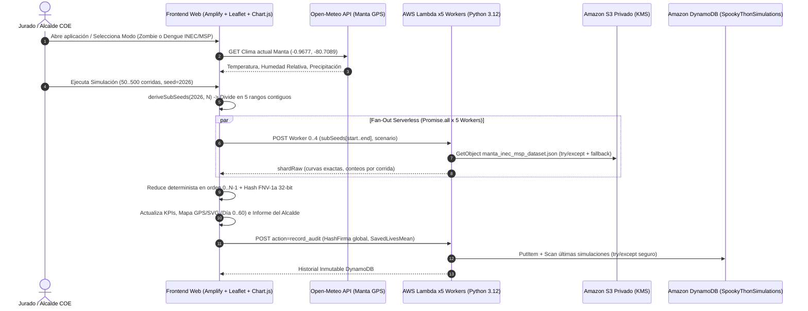

# Technical Design Document — `manta-epidemic-shield`

## 1. Arquitectura General Multicapa

---

## 2. Garantía Matemática del Fan-Out Determinista (MapReduce Serverless)

Para garantizar que $N \in [50, 500]$ corridas divididas en $W = 5$ peticiones concurrentes produzcan **exactamente el mismo resultado y `HashFirma`** que $1$ petición secuencial:

1. **Partición Determinista de Sub-Semillas:**
   Dado `seed` maestro $s_0$, tanto JavaScript como Python generan el mismo vector determinista $\mathbf{S} = [s_0, s_1, \dots, s_{N-1}]$ mediante aritmética entera de 32 bits `mulberry32`. El cliente particiona $\mathbf{S}$ en $5$ rebanadas disjuntas y ordenadas $\mathbf{S}^{(0)}, \dots, \mathbf{S}^{(4)}$.
2. **Independencia entre Trayectorias:**
   Cada trayectoria $r$ instancia sus propios generadores independientes a partir de $s_r$:
   - `epi_rng` $= \text{RNG}(s_r)$ (consume exactamente 2 uniformes por llamada binomial para mantener *Números Aleatorios Comunes* entre las 3 estrategias).
   - `policy_rng` $= \text{RNG}(s_r \oplus \text{0x9E3779B9})$.
   - `eff_rng` $= \text{RNG}(s_r \oplus \text{0x517CC1B7})$.
3. **Reducción Exacta y Firma FNV-1a:**
   Cada worker devuelve `shardRaw` con las sumas diarias sin redondear y los vectores por corrida `(infected[i], doses[i], spent[i])`. El coordinador concatena los 5 fragmentos en orden estricto $w = 0, 1, 2, 3, 4$, divide las sumas totales para $N$ y aplica la función hash FNV-1a (`offset_basis = 0x811C9DC5`, `prime = 0x01000193`) en orden $r = 0 \dots N-1$.

---

## 3. Algoritmo `"Escudo de Centralidad + Cerco Perimetral Adaptativo"`

Para cada día $t \in \{1 \dots T\}$ y barrio $k \in \{0 \dots 7\}$:
1. **Fase de Contención en Origen (`Cerco Sanitario` + `Fumigación`):**
   - Si el foco activo $k$ presenta carga infecciosa $(I_k + 0.5 E_k)$ elevada o es el nodo origen central (ej. *Mercado de Tarqui*, grado $4$), se prioriza el **Cerco Sanitario (`$3,500`, $-75\%$ flujo inter-barrial)** y la **Brigada de Fumigación (`$1,200`, $-40\%$ transmisión local por $5\text{ días}$)**.
2. **Fase de Anillo Perimetral de Vacunación (`$15/dosis`, solo `🟢 Sanos`):**
   - El puntaje base $\text{Grado}_k \cdot \left(\sum_{j \in \mathcal{N}(k)} I_j\right) \cdot \frac{S_k}{N_k}$ se modula por el multiplicador perimetral $\psi_k$:
     - $\psi_k = 0.18$ si $k$ es un nodo central ya expuesto con vecinos aún sanos (evita desperdiciar dosis dentro del foco ya incubando).
     - $\psi_k = 2.35$ si $k$ es un barrio vecino sano colindante a un hub infectado (levanta un cortafuegos inmunológico alrededor del epicentro).
3. **Auto-Optimizador Presupuestario:**
   - Explora determinísticamente una malla de portafolios tácticos bajo la semilla activa (variando combinaciones de intervenciones habilitadas y ritmo diario de despliegue) y selecciona el portafolio $\pi^*$ que maximiza $\mathbb{E}[\text{Vidas Salvadas}(\pi)]$.

---

## 4. Diseño de Datos y Seguridad en AWS (`infra/template.yaml`)

- **Bucket S3 Privado (`MantaCalibrationDatasetBucket`):** Cifrado `aws:kms` con rotación anual automática, versionado activo, política TLS obligatoria y las 4 banderas `PublicAccessBlock` en `true`.
- **Tabla DynamoDB (`SpookyThonSimulations`):** Clave primaria `SimulationId` (String), facturación `PAY_PER_REQUEST`, cifrado `SSE-KMS` con clave administrada por el cliente y *Point-in-Time Recovery (PITR)* habilitado.
- **Rol IAM Lambda:** Permisos acotados estrictamente a los ARN exactos del objeto de calibración en S3, de la tabla `SpookyThonSimulations` en DynamoDB y de su propio `LogGroup` en CloudWatch.
