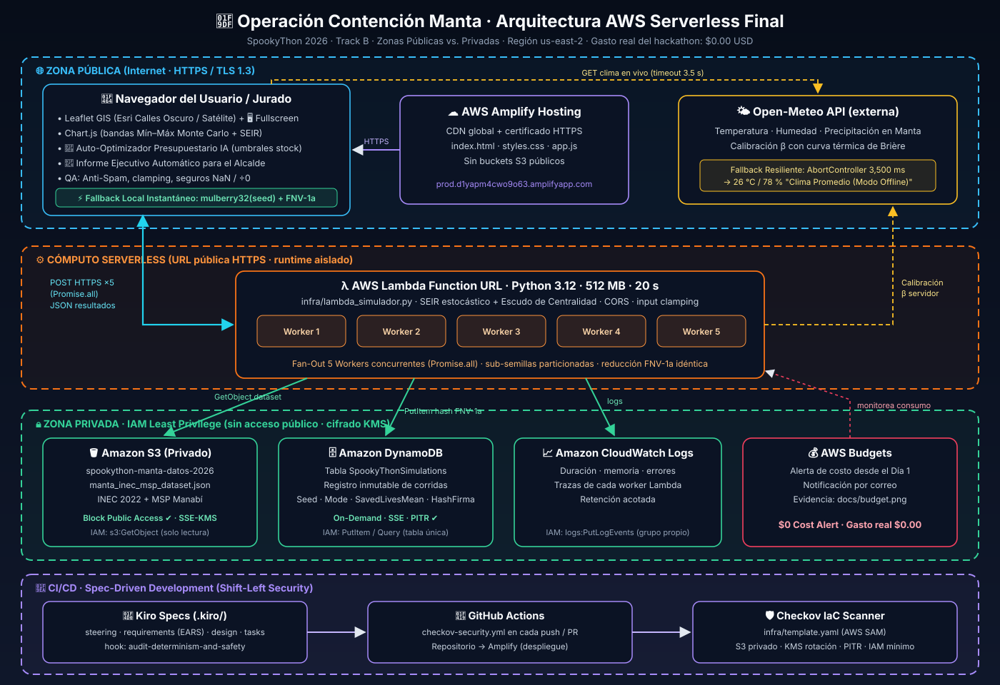
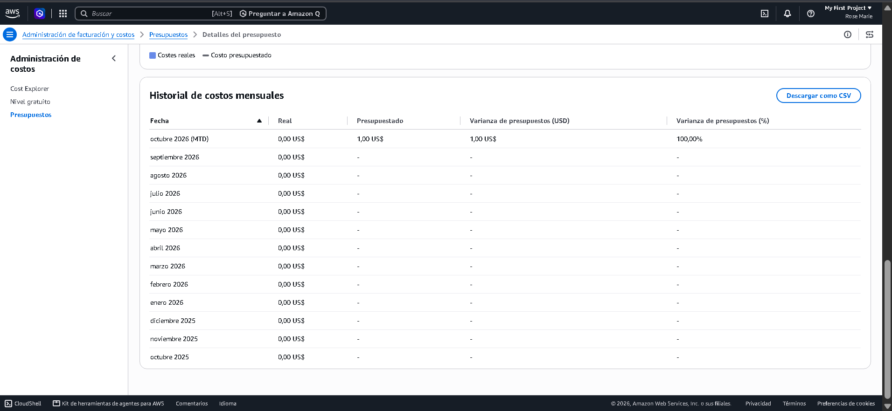

# 🧟‍♂️🛡️ Operación Contención Manta — Simulador Epidemiológico Monte Carlo (SpookyThon 2026 · Track B)

🌐 **Demo en Vivo / Aplicación Desplegada (AWS Amplify):** [https://prod.d1yapm4cwo9o63.amplifyapp.com/](https://prod.d1yapm4cwo9o63.amplifyapp.com/)

> **Sistema de apoyo a la toma de decisiones en tiempo real para el COE Cantonal y la Alcaldía de Manta.**  
> Modela, audita y optimiza la contención de un brote epidémico explosivo sobre la red urbana real de **8 barrios y 100,000 habitantes de Manta (Manabí, Ecuador)** mediante simulaciones estocásticas **SEIR + Monte Carlo 100% reproducibles por semilla**, operando sobre una arquitectura híbrida **AWS Serverless + Fallback Local Instantáneo**.

---

## 📌 1. ¿Qué hace el proyecto y cómo resuelve la contención en Manta?

Durante una emergencia epidémica real, las autoridades municipales enfrentan tres restricciones críticas simultáneas: **presupuesto limitado**, **llegada escalonada de insumos por día** y **incertidumbre biológica** (variantes con escape vacunal parcial). Repartir vacunas o brigadas a ciegas por toda la ciudad diluye el impacto y permite que los nodos centrales de transporte disparen el contagio hacia toda la urbe.

**Operación Contención Manta** traduce la narrativa de *Track B (La Plaga Zombie)* en un gemelo epidemiológico riguroso inspirado directamente en dos dinámicas reales de salud pública en la costa de **Manabí**:
1. **Brotes vectoriales costeros (Dengue / *Aedes aegypti*):** Donde la intervención química barrial (**Brigadas de Fumigación**) abate de forma temporal (`5 días`, `-40%`) la fuerza de infección local en los barrios foco como *Los Esteros* o *Tarqui*, ganando tiempo vital aunque sin conferir inmunidad permanente.
2. **Virus respiratorios de alta transmisibilidad urbana (Influenza / SARS-CoV-2):** Donde los grandes nodos articuladores de movilidad interbarrial (*Mercado de Tarqui*, *Terminal Terrestre* y *Centro de Manta*) actúan como puentes superpropagadores, exigiendo combinar **Vacunación Preventiva Estricta a Población Sana** con **Cierres Selectivos de Corredores Viales** (`-75%` de flujo inter-nodo).

### Solución Algorítmica: *"Escudo de Centralidad y Riesgo"*
El simulador compara simultáneamente, bajo exactamente los mismos escenarios estocásticos (*Números Aleatorios Comunes*), **3 estrategias** respetando la **Regla Estricta Inquebrantable** de vacunar **únicamente a población `🟢 Sana (S)`** (prohibido desperdiciar dosis en `🟡 Mordidos/Expuestos`, `🔴 Zombies/Infecciosos` o `🔵 Exorcizados/Inmunes`):

1. **Línea Base 1 — Sin Intervención:** `0` dosis y `` `$0` `` ejecutados (evolución natural del brote).
2. **Línea Base 2 — Intervención al Azar:** Asigna el mismo presupuesto y flujo diario de vacunas/brigadas de forma uniforme/aleatoria únicamente entre población `🟢 Sana`, sin inteligencia topológica.
3. **Nuestra Estrategia — *"Escudo de Centralidad y Riesgo"*:**
   - **Corta cuellos de botella viales:** Prioriza cada día a los barrios puente según el índice topológico-epidemiológico:
     $$\text{Puntaje}_i(t) = \text{Conexiones}_i \times \left(\sum_{j \in \mathcal{N}(i)} I_j(t)\right) \times \frac{S_i(t)}{N_i}$$
   - **Apaga el foco inicial:** Despliega fumigación intensiva y control selectivo sobre el epicentro activo en las primeras 48 horas mientras levanta un anillo inmunológico en los nodos vecinos más conectados.
   - **Se adapta ante "Brotes Sorpresa":** Si el Jurado reduce la efectividad de la vacuna (ej. `35%` por variante resistente), el motor protege automáticamente mayor reserva presupuestaria para cierres viales y fumigación en lugar de depender solo del biológico.
   - **Traduce ciencia en acción pública:** Genera automáticamente un **Informe Ejecutivo sin tecnicismos para el Alcalde de Manta**, acompañado de un **Mapa SVG interactivo y animado día a día (Día 1 a Día 60)**.

---

## 🏗️ 2. Arquitectura Cloud Serverless en AWS



📄 **Archivo fuente editable del diagrama (diagrams.net / draw.io):** [`docs/arquitectura.drawio`](docs/arquitectura.drawio)

### Flujo de Componentes Públicos y Privados
| Componente | Clasificación | Rol en la Arquitectura |
| :--- | :---: | :--- |
| **Usuario / Jurado + Fallback Local** | `🌐 PÚBLICO` | Interfaz web interactiva en el navegador (`HTTPS / TLS 1.3`). Incluye el motor determinista `mulberry32(seed)` en cliente que responde en `~12 ms` si se desconecta la red en pleno pitch. |
| **AWS Amplify Hosting** | `🌐 PÚBLICO` | Hospedaje estático administrado con CDN global y certificado HTTPS automático para servir `src/index.html`, `src/styles.css` y `src/app.js` **sin usar buckets S3 públicos**. |
| **AWS Lambda Function URL (`us-east-2`)** | `🌐 URL PÚBLICA` / `🔒 RUNTIME PRIVADO` | Endpoint HTTPS serverless (`POST` / `OPTIONS` con CORS) que ejecuta [`infra/lambda_simulador.py`](infra/lambda_simulador.py) en **Python 3.12** usando solo librerías estándar (`json`, `math`, `random`). |
| **AWS IAM Execution Role** | `🔒 PRIVADO` | Rol de ejecución con **Principio de Mínimo Privilegio** (`AWSLambdaBasicExecutionRole`), restringido exclusivamente a escribir trazas en CloudWatch. |
| **Amazon CloudWatch Logs** | `🔒 PRIVADO` | Recolección privada de telemetría operativa (duración, memoria consumida, invocaciones y trazas de ejecución). |
| **AWS Budgets** | `🔒 PRIVADO (Día 1)` | Gobernanza financiera activa desde el primer día con alerta configurada en `` `$1.00 USD/mes` ``. |

---

## 💰 3. Gobernanza Financiera y Presupuesto Obligatorio (AWS Budgets)

Desde el **Día 1** del proyecto se configuró una alerta activa en **AWS Budgets** con techo mensual de `` `$1.00 USD` ``. El gasto real acumulado durante todo el hackathon fue de **`$0.00 USD`** (`100%` cubierto por *AWS Free Tier / Sandbox Credits*).



- **Operación mensual estándar (`10,000` simulaciones/mes · `512 MB RAM` · `500 ms`):** `2,500 GB-s/mes` $\rightarrow$ **`$0.00 USD / mes`** dentro de la Capa Gratuita de AWS.
- **Escenario de tráfico masivo regional (`150,000` simulaciones/mes sin Capa Gratuita):** **`~$1.25 USD / mes`**.
- 📊 Consulta el desglose completo con fórmulas matemáticas paso a paso en **[`docs/costos.md`](docs/costos.md)**.

---

## 🧬 4. Supuestos Epidemiológicos y Origen de los Números

### 4.1. Red Urbana de Manta (8 Nodos Reales · `100,000` Habitantes · 13 Aristas)
Las poblaciones representan una cohorte urbana normalizada a `100,000` habitantes que preserva la proporción demográfica y el peso de movilidad real entre parroquias y polos urbanos de Manta (eje comercial Tarqui–Esteros–Centro, polo universitario ULEAM, corredor costero Murciélago–San Mateo y nodo hospitalario Rodríguez Zambrano):

| # | Nodo / Barrio de Manta | Población ($N_i$) | Grado | Conexiones Viales Directas (Aristas de Contacto) | Rol Urbano y Epidemiológico |
| :-: | :--- | :---: | :---: | :--- | :--- |
| `0` | **Mercado de Tarqui** | `15,000` | `4` | Centro, Los Esteros, Terminal, Hospital | Hub de abastecimiento comercial de alta densidad de contacto diario. |
| `1` | **Terminal Terrestre** | `12,000` | `4` | Mercado, ULEAM, Los Esteros, Centro | Puerta de tránsito cantonal y conector rápido este–oeste. |
| `2` | **Centro de Manta** | `18,000` | `4` | Mercado, Terminal, Playa Murciélago, Hospital | Núcleo administrativo/financiero de mayor población; puente central. |
| `3` | **ULEAM** | `14,000` | `3` | Terminal, Playa Murciélago, San Mateo | Polo estudiantil universitario que enlaza el eje norte con el sur-oeste. |
| `4` | **Playa El Murciélago** | `10,000` | `3` | Centro, ULEAM, San Mateo | Corredor turístico y gastronómico del borde costero. |
| `5` | **Hospital Rodríguez Zambrano** | `8,000` | `3` | Centro, Mercado, San Mateo | Infraestructura sanitaria crítica; requiere blindaje temprano. |
| `6` | **Los Esteros** *(Foco defecto)* | `16,000` | `2` | Mercado, Terminal | Parroquia pesquera densa; conectada directamente a dos super-hubs de grado 4. |
| `7` | **San Mateo** | `7,000` | `3` | ULEAM, Playa Murciélago, Hospital | Nodo costero periférico sur-occidental. |

### 4.2. Parámetros Biológicos SEIR y Costos Logísticos de Intervención

| Parámetro | Símbolo | Valor por Defecto | Rango UI | Origen Técnico / Epidemiológico del Supuesto |
| :--- | :---: | :---: | :---: | :--- |
| **Tasa de transmisión base** | $\beta$ | `0.72` $\text{día}^{-1}$ | `0.15 – 1.60` | Calibrada junto a $\gamma = 0.20$ para un número reproductivo básico local $R_0 = \beta/\gamma = 3.6$, consistente con brotes epidémicos intensos de dengue urbano y virus respiratorios en ciudades costeras de Manabí. |
| **Acoplamiento inter-barrial** | $\alpha$ | `0.025` | Fijo en modelo | Fracción diaria de mezcla efectiva por desplazamientos laborales/comerciales entre barrios vecinos ponderada por el grado vial ($\text{Grado}_i / 3$). |
| **Dispersión estocástica diaria** | $\eta_{i,t}$ | $\mathcal{U}(0.60, 1.40)$ | Determinista por semilla | Captura la variabilidad diaria de aglomeraciones urbanas (horas pico en mercados/terminales vs. días valle) manteniendo media unitaria $\mathbb{E}[\eta]=1.0$. |
| **Periodo de incubación** | $\sigma^{-1}$ | `3 días` ($\sigma = 0.333$) | `1 – 10 días` | Latencia biológica entre exposición (`🟡 Mordido/E`) e infecciosidad activa (`🔴 Zombie/I`), análoga a infecciones respiratorias agudas de rápida progresión. |
| **Tasa de recuperación / exorcismo** | $\gamma$ | `0.20` $\text{día}^{-1}$ | Fijo (`5 días` med.) | Ventana infecciosa activa promedio de `5 días` ($\gamma^{-1} = 5$) antes de neutralización, aislamiento clínico o inmunización post-infección (`🔵 R`). |
| **Brote inicial (Paciente Cero)** | $I_0$ | `10` casos en *Los Esteros* | Cualquier barrio | Clúster inicial detectado por vigilancia epidemiológica antes de la activación del COE Cantonal en el Día 1. |
| **Efectividad de la vacuna** | $e$ | `85%` | `10% – 100%` | Probabilidad Bernoulli/Binomial de seroconversión protectora real en individuos `🟢 Sanos`; ajustable para simular variantes parcialmente resistentes. |
| **Costo por dosis de vacuna** | $C_{\text{vac}}$ | `` `$15 USD` `` / dosis | Check activable | Costo unitario integral (biológico + cadena de frío + aplicación en brigada) referenciado a campañas de inmunización de emergencia. |
| **Brigada de Fumigación** | $C_{\text{fum}}$ | `` `$1,200 USD` `` / barrio | Check activable | Operativo barrial de termonebulización y control de foco (reduce contagio local `-40%` durante `5 días`), basado en cuadrillas antivectoriales municipales. |
| **Cierre Selectivo de Nodo** | $C_{\text{close}}$ | `` `$3,500 USD` `` / barrio | Check activable | Punto de control sanitario y restricción vehicular en accesos del barrio (reduce flujo con barrios vecinos en `-75%` sin asfixiar suministros vitales). |

---

## 🔥 5. Prueba de Fuego del Jurado — Reproducibilidad Exacta (`seed: 2026`)

El simulador prohíbe el uso de `Math.random()` en JavaScript y sincroniza todas sus extracciones pseudoaleatorias a partir de la semilla numérica ingresada. Misma semilla + mismos parámetros = **exactamente los mismos resultados bit a bit** en cualquier ejecución.

### 5.1. Parámetros Oficiales por Defecto
Al abrir la aplicación (o pulsar **`↺ Restaurar Defecto`**), el tablero carga exactamente esta configuración:
- **Semilla Numérica (`seed`):** `2026`
- **Corridas Monte Carlo (`runs`):** `50`
- **Horizonte (`days`):** `60 días`
- **Barrio Paciente Cero (`initialNode`):** `Los Esteros (16.000 hab.)` *(índice `6`)*
- **Tasa de Contagio ($\beta$):** `0.72` | **Días de Incubación ($\sigma^{-1}$):** `3 d`
- **Stock Regional de Vacunas:** `24,000` dosis | **Efectividad de la Vacuna:** `85%`
- **Presupuesto Total:** `` `$50,000` `` | **Llegada Diaria:** `800 dosis/día` y `2 brigadas/día`
- **Intervenciones Activas:** `☑ Vacuna ($15)` + `☑ Fumigación ($1,200)` + `☑ Cierre Selectivo ($3,500)`

### 5.2. Guía Paso a Paso para Reproducir los Números Exactos
1. Abre la aplicación web desplegada en AWS Amplify (o abre `src/index.html` localmente en cualquier navegador moderno).
2. Verifica en la barra de auditoría superior que la semilla activa muestre `mulberry32(2026)` y la auditoría de regla estricta indique **`100% Solo 🟢 Sanos`** (`0` violaciones).
3. **Verificación en Modo Cloud AWS Lambda** *(endpoint precargado por defecto en `☁️ Conexión Cloud AWS Lambda`)*:
   - Haz clic en **`☁️ Sincronizar y Simular`** (o **`▶ Ejecutar Simulación Monte Carlo`**) y comprueba los números exactos de la columna **Cloud AWS Lambda (`0x45949A6E`)** en la tabla inferior.
4. **Verificación en Modo Motor Local + Prueba Doble Bit a Bit**:
   - Haz clic en **`⚡ Modo Local`** (o en el botón superior **`✓ Verificar Reproducibilidad`**). El sistema ejecutará dos corridas independientes de `50 × 3 × 60` días en milisegundos y mostrará el banner verde confirmando igualdad exacta con el hash **`0x99285FE0`**.

### 5.3. Resultados Exactos Esperados (`seed: 2026` · `50` corridas · `60` días)

| Métrica Auditada | Motor Cloud AWS Lambda (`Python 3.12`) | Motor Local Navegador (`mulberry32` JS) |
| :--- | :---: | :---: |
| **Hash Determinista de Verificación** | `0x45949A6E` | `0x99285FE0` |
| **Violaciones a Regla Estricta (Vacunar no-sanos)** | **`0`** (`100% Solo 🟢 Sanos`) | **`0`** (`100% Solo 🟢 Sanos`) |
| **Sin Intervención — Infectados Acumulados** | `89,791` `[82,809 - 95,502]` | `90,423` `[79,944 - 94,918]` |
| **Intervención al Azar — Vidas Salvadas** | `9,980` `[3,725 - 28,788]` | `11,149` `[3,486 - 31,511]` |
| **Escudo de Centralidad y Riesgo — Vidas Salvadas** | **`63,273` `[20,678 - 75,027]`** | **`65,229` `[26,795 - 74,882]`** |
| **Escudo — Infectados Acumulados** | `26,519` `[15,101 - 73,931]` | `25,194` `[15,324 - 66,533]` |
| **Ventaja Neta vs. Reparto al Azar** | **`+53,293` vidas adicionales** | **`+54,080` vidas adicionales** |

---

## 🚀 6. Instrucciones de Despliegue y Pruebas

### 6.1. Ejecución Local Inmediata (Cero Instalación)
El frontend no requiere `npm install` ni bundlers:
```powershell
# Opción A: Servir con Python estándar en http://localhost:8080
python -m http.server 8080 --directory src

# Opción B: Abrir directamente src/index.html en Chrome, Edge o Firefox
```

### 6.2. Despliegue del Backend en AWS Lambda (`Python 3.12`)
1. En la consola de **AWS Lambda** (`us-east-2`), crear función desde cero con runtime **Python 3.12** y arquitectura `x86_64`.
2. Copiar el contenido íntegro de [`infra/lambda_simulador.py`](infra/lambda_simulador.py) en `lambda_function.py` (handler: `lambda_function.lambda_handler`) y pulsar **Deploy**.
3. En **Configuration $\rightarrow$ General configuration $\rightarrow$ Edit**, ajustar:
   - **Memory:** `512 MB`
   - **Timeout:** `0 min 20 sec`
4. Activar **Function URL** con `Auth type: NONE` (el propio código gestiona `OPTIONS` y las cabeceras CORS `Access-Control-Allow-Origin: *`) y pegar la URL en el campo `☁️ Conexión Cloud AWS Lambda` del tablero (ya configurada por defecto en [`src/app.js`](src/app.js)).

### 6.3. Despliegue del Frontend en AWS Amplify Hosting
1. En **AWS Amplify**, seleccionar **Deploy an app** (vía repositorio Git o paquete `.zip` del directorio `src/`).
2. Definir directorio raíz de artefactos en `src` (sin comando de build necesario al ser HTML5/CSS3/ES6 puro).
3. Amplify aprovisiona automáticamente distribución CDN y dominio público con certificado **HTTPS (TLS 1.3)**.

### 6.4. Pruebas Automatizadas de Verificación (Backend y Regla Estricta)
Ejecuta desde la raíz del proyecto para validar determinismo, cabeceras CORS y `0` violaciones de vacunación:
```powershell
python -c "import json, sys; sys.path.insert(0, 'infra'); import lambda_simulador as ls; ev={'requestContext':{'http':{'method':'POST'}},'body':json.dumps({'seed':2026,'runs':50,'days':60,'beta':0.72,'vaccines':24000,'vaccineEffectiveness':85,'initialNode':6,'budget':50000})}; r1=ls.lambda_handler(ev,None); r2=ls.lambda_handler(ev,None); d=json.loads(r1['body']); assert r1['body']==r2['body']; assert all(d['summary'][k]['violations']==0 for k in ('none','random','shield')); print('OK Determinismo y Regla Estricta | Hash:', d['hashHex'], '| Salvados:', d['strategies']['estrategiaInteligente']['savedMean'])"
```

---

## 🧠 7. Decisiones de Diseño

1. **Reducción de Varianza con Números Aleatorios Comunes (*Common Random Numbers*):** En cada corrida $r \in \{1..N\}$, las 3 estrategias comparten exactamente el mismo flujo estocástico de dispersión y contagio por día y nodo. Así, toda diferencia en vidas salvadas proviene genuinamente de la política sanitaria y no de ruido estadístico afortunado.
2. **Arquitectura Resiliente *Cloud-First + Local-Fallback*:** Durante demostraciones en vivo, la red del auditorio puede saturarse o caer. El cliente aplica `AbortController` y conmuta de forma transparente al motor local `mulberry32` en milisegundos sin interrumpir al presentador. Incluso si fallara el CDN de Chart.js, [`src/app.js`](src/app.js) incluye un renderizador vectorial Canvas 2D propio de respaldo.
3. **Cero Dependencias Externas en Lambda:** [`infra/lambda_simulador.py`](infra/lambda_simulador.py) prescinde de `numpy`/`scipy` e implementa inversión exacta de la CDF Binomial + transformación de Box-Muller usando solo `json`, `math` y `random`, reduciendo el paquete de despliegue a `< 35 KB` y eliminando vulnerabilidades de cadena de suministro (*supply-chain*).

---

## 🔐 8. Seguridad Aplicada

- **Principio de Mínimo Privilegio (IAM):** La función AWS Lambda utiliza exclusivamente un rol básico de ejecución limitado a `logs:CreateLogGroup`, `logs:CreateLogStream` y `logs:PutLogEvents` sobre su propio grupo en Amazon CloudWatch, sin permisos de lectura ni escritura sobre ningún otro recurso de AWS.
- **Cero Credenciales en Código Fuente:** No existen `AWS_ACCESS_KEY_ID`, `AWS_SECRET_ACCESS_KEY`, tokens ni secretos embebidos en el repositorio ni en variables expuestas al navegador.
- **Sin Buckets S3 Públicos:** El frontend estático se publica a través de **AWS Amplify Hosting** con HTTPS obligatorio; la cuenta mantiene bloqueado el acceso público a S3 (*Block All Public Access*).
- **Validación y Acotamiento de Entrada (*Input Clamping*):** `parse_scenario_payload` valida tipos y restringe rangos numéricos en el servidor (`runs <= 300`, `days <= 365`, `budget <= 2,000,000`) para prevenir abusos computacionales o denegación de billetera (*Denial-of-Wallet*).

---

## ⚠️ 9. Limitaciones Conocidas

1. **Homogeneidad Intra-Barrial:** Cada uno de los 8 barrios de Manta se modela como una subpoblación bien mezclada (*compartmental metapopulation*); no distingue micro-redes domiciliarias ni grupos de edad (niños, adultos mayores, personal médico).
2. **Movilidad Diaria Estacionaria:** Las aristas del grafo utilizan pesos de acoplamiento diarios constantes y no diferencian picos horarios matutinos/vespertinos ni flujos extraordinarios por feriados turísticos hacia *Playa El Murciélago* o *San Mateo*.
3. **Ejecución HTTP Síncrona:** Para garantizar respuesta interactiva en pocos segundos y proteger la cuota gratuita de AWS Lambda, las corridas en línea se acotan a `300` iteraciones Monte Carlo por petición.

---

## 📂 Estructura del Repositorio

```text
spookython-manta-zombie/
├── README.md                    # Documentación integral, supuestos y Prueba de Fuego (seed: 2026)
├── docs/
│   ├── arquitectura.svg         # Diagrama de arquitectura vectorial (Público vs. Privado)
│   ├── arquitectura.drawio      # Archivo fuente XML editable para diagrams.net / draw.io
│   ├── budget.png               # Evidencia obligatoria de AWS Budgets activo desde el Día 1
│   └── costos.md                # Modelo matemático y declaración de costos en AWS ($0.00 real)
├── infra/
│   └── lambda_simulador.py      # Backend AWS Lambda Python 3.12 (solo json, math, random)
└── src/
    ├── index.html               # Tablero táctico COE Manta, Mapa SVG y conexión Cloud AWS
    ├── styles.css               # Diseño oscuro de alto contraste epidemiológico y responsivo
    └── app.js                   # Motor SEIR determinista mulberry32(seed), gráficas e Informe Alcalde
```
